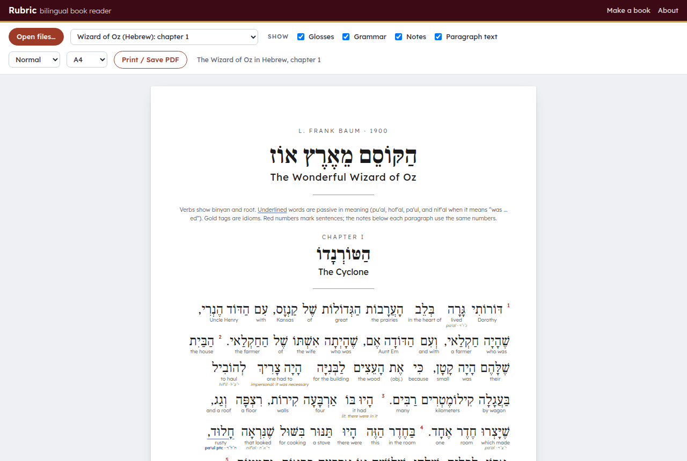

# Bilingual Book Maker (Rubric): interlinear editions of free books

*Why Rubric? In old manuscripts the headings were written in red ink, and the Latin for the red earth pigment, rubrica, gave them their name.*

**Runs on** any web browser: nothing to install. The translating is done by Claude, in a free claude.ai chat or in Claude Code.

**Version 1.0.**

Part of [Veered](https://veered.org): free tools, shared as-is. Questions: support@veered.org

**Use it now: [veered.org/bilingual-book-maker/app/](https://veered.org/bilingual-book-maker/app/)**

Rubric turns a free book into a reading edition for someone learning a language. Every sentence is translated, every word has a small gloss under it, the verbs are tagged with their grammar, and about one sentence in three gets a short teaching note. The pages print well, so you can read on paper with a pencil.

## The example: The Wonderful Wizard of Oz in Hebrew
`examples/wizard-of-oz/` holds the whole book, all 24 chapters and 3,088 sentences, translated into modern Israeli Hebrew for an English speaker at about A2–B1. Every word has full vowels (niqqud) and a gloss, every verb shows its binyan and root, passive forms are underlined, and idioms are marked. Open it in the reader: [reader.html?example](https://veered.org/bilingual-book-maker/app/reader.html?example), or look at [the chapter 1 PDF](examples/wizard-of-oz/wizard-of-oz-chapter-1.pdf). Its brief is in [examples/wizard-of-oz/STYLE.md](examples/wizard-of-oz/STYLE.md).

## How it works
1. **Choose a book** on the book maker page (`index.html`). Search Project Gutenberg's 75,000 free books, or paste a link to a Gutenberg book, a Wikipedia article, a Wikisource text, a Standard Ebooks book, a Project Ben-Yehuda story or any page with the text on it. The page also lists good places to look.
2. **Choose your languages and level**: the language you're learning, your own language (for the glosses and notes), and your level from A1 to C1. Each language gets its own grammar recipe: binyan and root for Hebrew, tense and mood for Spanish, aspect and case for Russian, furigana for Japanese, pinyin for Chinese, and so on. If the book is already in the language you're learning, Claude keeps its words and adds the glosses, notes and a translation instead.
3. **Copy the instructions to Claude.** In a free [claude.ai](https://claude.ai) chat, Claude makes one chapter per chat as a `.json` file. In [Claude Code](https://claude.com/claude-code), it downloads the text, splits it into chapters, translates them, and checks each one against the original with `tools/validate.js`.
4. **Open the files in the reader** (`reader.html`) and click *Print / Save PDF*. Switches turn the glosses, grammar tags, notes and original paragraph on or off, and there are compact and large sizes. For a booklet, print two pages per sheet.

Nothing is uploaded: the reader opens your files in the browser. The book search runs on a copy of Project Gutenberg's catalogue (`catalog.tsv`, rebuilt with `tools/build_catalog.py`), and Wikipedia links are looked up with the Wikipedia API.

## Files
- `index.html`, `app.js`: the book maker.
- `reader.html`, `reader.js`, `reader.css`: the reader and print layout.
- `FORMAT.md`: the data format Claude writes (one JSON file per chapter, or several per chapter for long ones).
- `catalog.tsv`: Project Gutenberg's catalogue, most downloaded first, for the book search. `tools/build_catalog.py` rebuilds it from Gutenberg's catalogue and download counts.
- `tools/validate.js`: `node tools/validate.js data/ch01.json src/ch01.txt` checks the tokens and that the original text is reproduced word for word. Node only, no packages.
- `examples/wizard-of-oz/`: the finished Hebrew edition, its brief and the English source text.

## Copyright
Use texts that are free to translate. Project Gutenberg books are public domain in the United States; check your own country's rules too. Wikipedia articles are under CC BY-SA 4.0, so an edition made from one must credit the article and its authors and use the same license, and the instructions ask Claude to put that credit in the book.

Claude can make mistakes. Treat the glosses and notes as a study aid, and check anything important with a teacher or a dictionary.

## License
The code is under the MIT License. The Hebrew translation, glosses and notes of the Wizard of Oz example are under [CC BY 4.0](https://creativecommons.org/licenses/by/4.0/); Baum's English text is in the public domain.
